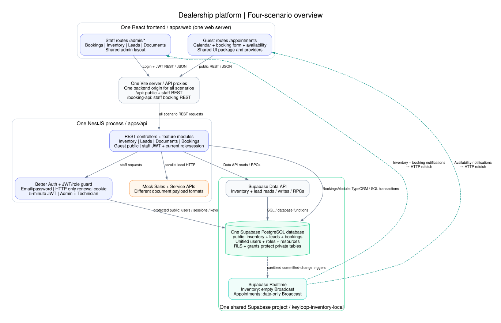
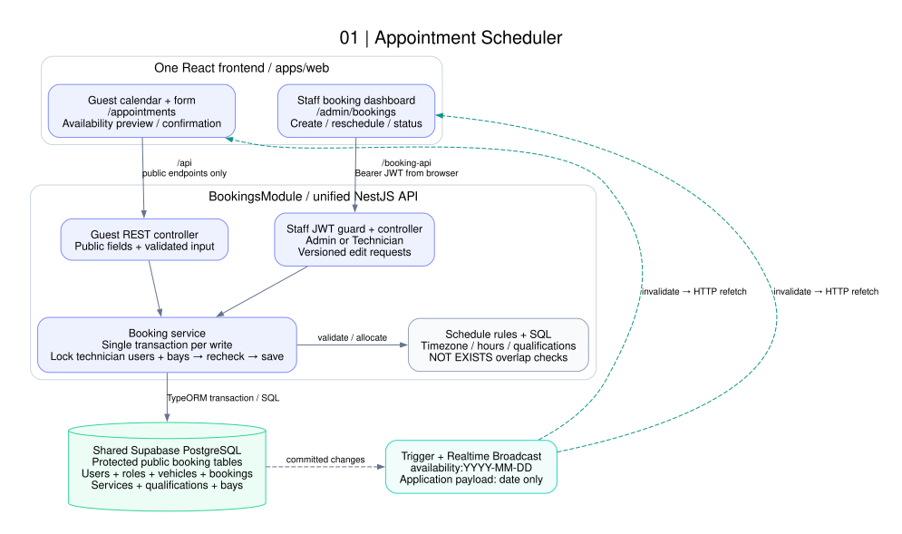
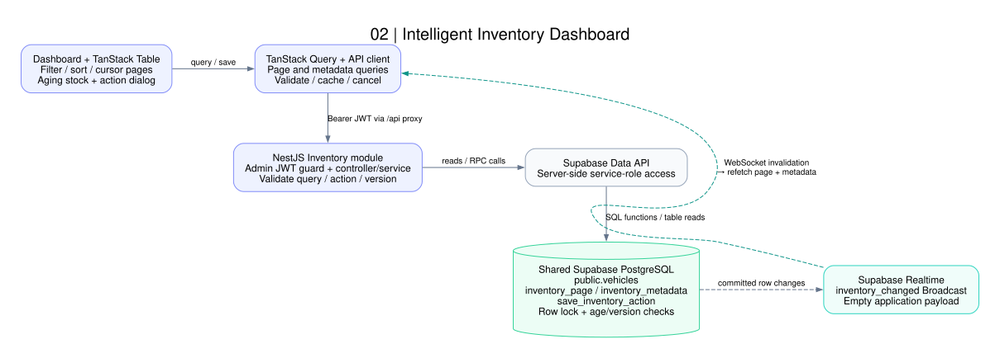
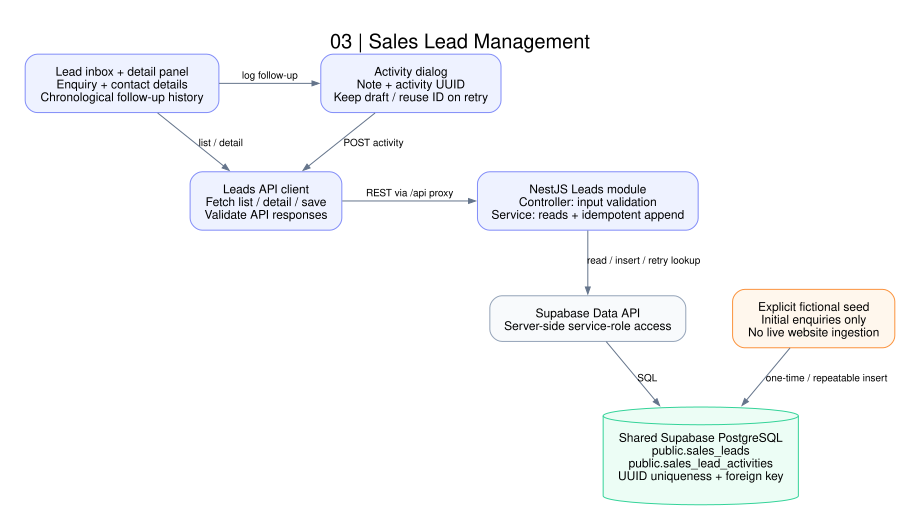
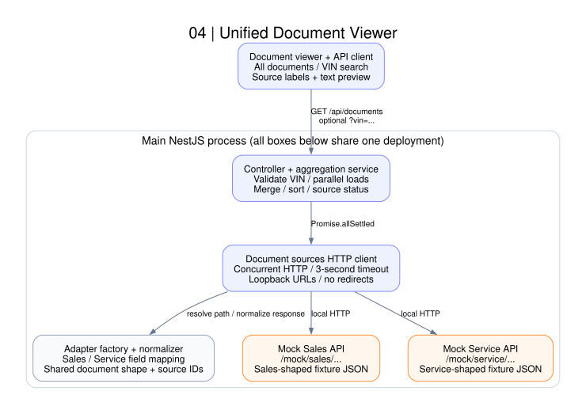
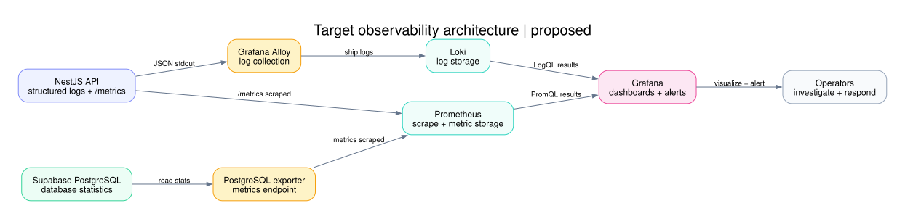

# Part 1: System Design Document

This document describes the four implemented dealership scenarios: Appointment
Scheduler, Intelligent Inventory, Sales Lead Management, and Unified Document
Viewer. It covers the architecture diagrams, component responsibilities,
end-to-end data flow, technology choices, observability strategy, and use of GenAI
during the design phase.

The document describes the implementation as of 23 October 2026:
one frontend, one NestJS API, and one shared Supabase PostgreSQL project, with Better Auth JWT staff access.
Solid arrows show requests or database access; dashed arrows show change
notifications. HTTP responses return along the request path.

| Part 1 requirement | Where to find it |
| --- | --- |
| Architecture diagram | [Overall architecture](#1-overall-architecture) and the four scenario diagrams in sections 2–5 |
| Component roles | Component tables in sections 1–5 |
| Data flow | [End-to-end data flow](#6-end-to-end-data-flow) |
| Technologies and justifications | [Technology choices and tradeoffs](#7-technology-choices-and-tradeoffs) |
| Logging, metrics, and tracing strategy | [Observability strategy](#8-observability-strategy), separating implemented diagnostics from the proposed Loki, Prometheus, and Grafana stack |
| GenAI assistance in the design phase | [GenAI-assisted design](#9-genai-assisted-design) |

## 1. Overall architecture

One React application serves the staff scenarios and guest booking pages.
`/admin/*` routes share the admin layout; `/appointments` and its availability
routes use the guest interface outside that layout. Both run from the same web
server and share the UI package and application providers. One NestJS process
hosts Inventory, Leads, Documents, and Bookings modules through `AppModule`.
`BookingsModule` contains both guest and guarded staff endpoints, the resource
allocator, and its TypeORM connection. All application code, scheduler migrations,
and tests live in this workspace; the old appointment worktree is no longer a
runtime or build dependency. The document sources are mock HTTP endpoints hosted
inside this same API process rather than independently deployed services.

**Shared database:** Supabase provides PostgreSQL; they are not two different
database technologies. The implementation uses one Supabase project and one
PostgreSQL database. All application tables live in `public`, including appointments and Better Auth.
Booking and auth tables have RLS enabled and browser-role privileges revoked. Inventory and leads access
the database through the Supabase Data API; BookingsModule connects to the same
database through TypeORM. Both features use the project's Realtime service.

The running demo uses the retained `keyloop-inventory-local` project (Data API
55321, PostgreSQL 55322). Existing scheduler data and TypeORM migration history
were copied into it after restoring and comparing both backups. The former
scheduler stack is stopped with recoverable storage retained. See the
[database merge runbook](database-merge.md). Booking and auth tables now share the exposed `public` namespace, but RLS and
explicit grants prevent browser access; migration history also denies browser roles.

| Component | Role |
| --- | --- |
| React frontend | Provides all staff and guest routes in `apps/web`. React Router keeps the admin navigation mounted while switching `/admin/*` scenarios and lazy-loads guest pages outside that layout. |
| Guest booking feature | Provides `/appointments`, its `/availability` alias, and `/appointments/monitor` inside the same frontend. It handles the customer calendar, service selection, availability checks, and booking confirmation. Creation uses a retry-stable UUID idempotency key. |
| Shared UI package | Supplies the Keyloop theme and reusable tables, dialogs, inputs, calendars, and other interface components. It is a build-time dependency, not a network service. |
| Local Vite proxies | All default to the same `INVENTORY_API_ORIGIN`. `/api` forwards feature/auth requests and `/booking-api` forwards staff booking requests with the browser JWT. Public booking endpoints also use `/api`; staff access is enforced by the backend guard. |
| Better Auth and React session provider | Authenticate staff with email/password, keep an HTTP-only session cookie for renewal, and issue five-minute JWT access tokens held only in browser memory. Login/logout clear cached staff data. |
| NestJS JWT and role guard | Verify signature, issuer, audience and expiry, then read the current session and role. Admin accesses all modules; Technician accesses every booking feature, including rescheduling. Explicit guest endpoints remain public. |
| Unified NestJS API | Hosts Inventory, Leads, Documents, and Bookings as feature modules in one application. A shared bootstrap loads configuration, validates DTOs, configures CORS, and closes resources on shutdown. |
| BookingsModule | Owns guest and admin booking endpoints, scheduling rules, resource allocation, and transactional writes inside the same API process. Its scheduler database configuration is required at startup. |
| Shared Supabase PostgreSQL database | Persists all application tables in `public`, with RLS and grants protecting bookings, unified identities, sessions and signing keys. Customers, staff and technicians share `users`, with explicit roles. `vehicles` stores inventory; `booking_vehicles` stores customer service vehicles. This is one database used by both storage adapters. |
| Supabase Data API | Exposes the inventory/lead table operations and inventory database functions used by the main API. Appointment transactions use a direct PostgreSQL connection through TypeORM. |
| Supabase Realtime | Delivers empty inventory invalidations and date-only appointment availability Broadcasts from the shared project. |
| Mock Sales and Service APIs | Simulate two document systems with different response formats. They return fictional documents over real local HTTP requests. |

Appointment Broadcast bodies contain only the date; inventory bodies are empty; this Supabase version
adds a generated message UUID as transport metadata. It contains no customer
or booking identifiers. Realtime messages prompt an authoritative HTTP refetch. They do not replace
database reads, confirm a save, or reserve appointment capacity.

## 2. Appointment Scheduler

Customers select a service, future open time, and available technician and bay. Staff manage the same
persisted bookings through a day/list dashboard. Both interfaces use the same
booking service and resource-allocation rules.

| Component | Role |
| --- | --- |
| Guest calendar and booking form | Show only the selected month's dates. Open the form from a future open day cell, generate hourly start choices from the schedule, and query available technicians and bays for the selected interval. Collect customer/vehicle details and explicit resource choices; submit the booking and display confirmation or a recoverable error. |
| Staff booking dashboard | Loads the catalog and selected day's bookings. Supports creation, rescheduling, cancellation, and permitted status changes; submits the expected booking version when editing. |
| Guest and admin REST controllers | Validate requests and expose the two API contracts. Guest routes return limited public fields; admin routes return the booking details needed for management. |
| Staff JWT/role guard | Requires a valid JWT and current unrevoked session. Admin and Technician can manage all bookings; permission comes from the current database role. Shared booking keys are no longer used. |
| Schedule rules and resource matcher | Apply dealership timezone, opening hours, service duration, and technician qualifications. Query free qualified technicians and bays using SQL `NOT EXISTS` checks over overlapping bookings. |
| Booking service and TypeORM connection | Execute booking writes in a single PostgreSQL transaction. Conditionally increment technician-user and bay scheduling versions, recheck booking occupancy, then persist the booking. Reuse the allocator for rescheduling; validate booking versions and legal status transitions for admin edits. |
| Protected booking tables in public | Store unified user profiles, customer vehicles, service types, technician qualifications, bays, and bookings in the shared database. Constraints preserve relationships; scheduling versions coordinate booking writers. RLS and revoked browser grants protect booking tables in the shared public namespace. |
| Availability trigger and Realtime Broadcast | Publish `availability_changed` after committed changes, scoped to dealership-local dates. The application payload contains the date; clients refetch affected data without broadcasting customer or booking details. |

Availability previews do not reserve resources. The transaction makes the final
allocation decision, and all booking writers must follow its resource-version claim
protocol. The current appointment model uses 60-minute services and whole-hour
starts; availability is queried directly from bookings without bitmaps or a cache.

**Implementation references:** Main workspace:
[`booking-api.ts`](../apps/web/src/admin/booking-api.ts),
[`useAdminBookings.ts`](../apps/web/src/admin/useAdminBookings.ts), and
[`watch-bookings.ts`](../apps/web/src/admin/watch-bookings.ts).
The main workspace also contains the [guest booking feature](../apps/web/src/booking/),
[BookingsModule](../apps/api/src/bookings/bookings.module.ts), and
[scheduler connection, migrations, and seed](../apps/api/src/database/).

## 3. Intelligent Inventory Dashboard

Managers browse inventory, filter and sort across the complete dataset, identify
stock older than 90 days, and save a current action with an optional note.

| Component | Role |
| --- | --- |
| Inventory dashboard, table, and action dialog | Display summary cards, filters, ordered sort keys, cursor navigation, vehicle details, and action editing. Aging means more than 90 dealership-local calendar days in stock. |
| TanStack Query and inventory API client | Fetch and validate pages and independent metadata, cache by query, cancel superseded requests, and retain previous rows during refreshes. TanStack Table uses manual server filtering and sorting. |
| Inventory controller and service | Expose inventory pages, metadata, individual vehicle reads, and action updates. Validate query/cursor/action inputs, supply dealership dates, and translate database failures into API errors. |
| Supabase Data API | Carries server-side table reads and PostgreSQL function calls using a service-role credential held by NestJS. Browser code receives only the public connection configuration used for Realtime. |
| Inventory table and functions in Supabase PostgreSQL | Store vehicle facts and the current action in the shared database. `inventory_page` applies filtering, ordered sorting, and cursor pagination; `inventory_metadata` calculates global counts and make/model options. `save_inventory_action` locks the vehicle, checks age and expected version, and atomically updates the action. |
| Supabase Realtime and subscription hook | Receive `inventory_changed` Broadcasts with no row payload. Browser roles have no direct inventory SELECT. Coalesce notifications and invalidate page/metadata queries; refetch on subscription and reconnection. Dealership midnight also refreshes age-dependent results. |

The database processes the full dataset before returning a page. A stale edit
returns a conflict instead of overwriting another manager's action. Only one
current action is stored per vehicle; it is not an action-history system.

**Implementation references:**
[`inventory API`](../apps/api/src/inventory/),
[`inventory UI`](../apps/web/src/admin/inventory/),
[`inventory schema`](../supabase/migrations/20261021000100_inventory.sql), and
[`query functions`](../supabase/migrations/20261022000100_inventory_query.sql).

## 4. Sales Lead Management

Staff browse enquiries, inspect customer and vehicle-interest details, and add
follow-up notes to a chronological activity history. Initial website enquiries
are seeded fictional records; live website ingestion is not implemented.

| Component | Role |
| --- | --- |
| Lead inbox and detail panel | Load cursor-paginated lead pages with a Load more control and the selected lead, show contact/enquiry details and chronological activities, and distinguish loading, empty, and error states. |
| Activity dialog and leads API client | Validate responses and submit a note with a client-generated activity UUID. Retain the draft and reuse its UUID when retrying an uncertain save. |
| Leads controller | Expose list, detail, and activity-creation endpoints; validate route IDs and submitted activity fields before invoking the service. |
| Leads service | Read leads and history and append activities through the Supabase Data API. Treat an identical repeated activity ID as a successful retry; reject conflicting reuse of the ID. |
| Lead and activity tables in Supabase PostgreSQL | Persist `sales_leads` and `sales_lead_activities` in the shared database. Foreign keys associate notes with leads, UUID primary keys prevent duplicate activities, and database timestamps establish saved history. Browser roles have no direct access to these tables. |

Successful saves update the visible history from the API response. This scenario
uses request/response updates; it has no Realtime subscription. It shares the
inventory Supabase configuration and the same database as appointments.

**Implementation references:**
[`leads API`](../apps/api/src/leads/),
[`leads UI`](../apps/web/src/admin/leads/), and
[`lead tables`](../supabase/migrations/20261021000300_sales_leads.sql).

## 5. Unified Document Viewer

Staff see one document list across Sales and Service, optionally filter by VIN,
and open a readable preview without leaving the dashboard.

| Component | Role |
| --- | --- |
| Document list, VIN search, and preview | Request all documents or a VIN-filtered result, display source labels and partial-result warnings, and render fictional document content as plain React text in a dialog. |
| Documents API client | Validate the aggregated response and source metadata; abort or ignore superseded searches so an older response cannot replace the current result. |
| Documents controller and aggregation service | Validate/normalize the search and load configured sources concurrently using `Promise.allSettled`. Merge and sort successful results and return per-source status/counts. Return partial results if one source fails, or a safe gateway error if all fail. |
| Document sources HTTP client | Forward the current Admin JWT to each configured loopback source with a three-second timeout and reject redirects. Mock sources enforce the same Admin permission. Keep HTTP transport separate from aggregation and source-specific field mapping. |
| Adapter factory, source adapters, and normalizer | Resolve a registered Sales or Service adapter, build its request path, map its payload to a shared document shape, validate fields, and namespace document IDs by source. |
| Mock Sales API | Return fictional sales documents using its own payload format from `/mock/sales/...` endpoints in the main NestJS process. |
| Mock Service API | Return fictional service documents using a different payload format from `/mock/service/...` endpoints in the same process. |

This scenario aggregates source responses on demand. It does not persist a
document copy, use object storage, or connect to production document systems.
Registering another adapter and source URL extends the aggregation path; source
labels and status metadata drive the existing UI.

**Implementation references:**
[`document API and adapters`](../apps/api/src/documents/) and
[`document UI`](../apps/web/src/admin/documents/).

## 6. End-to-end data flow

### Request entry and staff access

1. React Router selects a staff screen under `/admin/*` or a public guest booking
   page. In local development, Vite strips `/api` or `/booking-api` and forwards the request to the unified NestJS API. These
   proxies are development configuration; a deployed frontend would need an
   equivalent routing setup.
2. Staff sign in through `/api/auth/*`. Better Auth stores identities and sessions
   in protected `public.users` and auth support tables and sets an HTTP-only session cookie. The frontend obtains a
   five-minute JWT through that session and keeps it in memory.
   `authenticatedFetch` attaches the bearer token to feature requests and tries
   renewal once after a 401. Login/logout clear cached staff data.
3. The global staff guard verifies the JWT and queries the current database
   session and role before allowing access. Admin can use all scenarios;
   Technician can use staff bookings. Guest controllers explicitly bypass staff
   authentication and expose only their public contracts. Controllers and
   services validate inputs before performing feature operations.

The browser's Supabase public configuration is used for Realtime subscriptions,
not direct access to business tables. Inventory/lead Data API credentials and
direct PostgreSQL credentials stay in the API process.

### Feature reads, writes, and responses

| Scenario | End-to-end path |
| --- | --- |
| Appointments | Guest pages fetch schedule, services, and anonymous monthly calendar entries (`GET /bookings?month=YYYY-MM`) through `/api`. The form queries `GET /availability?serviceTypeId=...&startsAt=...` after selecting a time, receiving free qualified technicians and free bays from SQL. The standalone monitor still uses the preview API; staff fetch catalog and day records through `/booking-api/admin/bookings`. A confirmation `POST /bookings` with an idempotency key enters `BookingsService`, validates dealership-local hours and service qualifications, checks the guest-selected technician/bay using SQL overlap checks, conditionally claims their resource versions, and rechecks availability in one TypeORM transaction. Customer/vehicle records and the booking commit together. Staff reschedules (`PATCH /admin/bookings/:id`) and status changes use the same transaction path and expected booking versions. The HTTP response supplies the saved result; the staff query cache refetches the affected day. |
| Inventory | The screen sends filters, ordered sort keys, page size, and an optional cursor to `/api/inventory`, and requests metadata separately. NestJS validates them and calls `inventory_page`/`inventory_metadata` through the Supabase Data API. PostgreSQL processes the complete dataset and returns a page plus global summary/options. The API maps rows and adds cursor/date information; TanStack Query caches the result by query. An action PATCH includes `expectedVersion`; `save_inventory_action` locks/checks the row and age rule, updates atomically, and returns the saved vehicle. Stale versions return 409 rather than overwrite another edit. |
| Leads | `/api/leads?limit=50&after=<cursor>` returns lead pages with `nextCursor`; `/api/leads/:id` reads the selected enquiry and saved activity history through the Data API. Adding a note sends a client-generated UUID to the activity endpoint. The service inserts the note, or returns the existing activity for an identical UUID retry; conflicting reuse returns 409. The UI uses the saved response to update history. There is no live website ingestion or lead Realtime feed. |
| Documents | `/api/documents` carries an optional VIN. The API normalizes it and concurrently fetches Sales and Service over loopback HTTP, forwarding the Admin JWT. Each adapter validates and maps its source format; aggregation sorts the shared document records and returns source statuses/counts. A failed source produces partial results and a UI warning; all sources failing produces 502. Previews render returned fictional content as text; no document is copied into PostgreSQL or object storage. |

The public monthly calendar returns only appointment times and service labels.
Selected-time availability loads the service duration, validates hours, then uses
one resource SQL statement returning both named lists. `NOT EXISTS` excludes any
non-cancelled booking overlapping the requested interval; technician role,
qualification and banned-state checks determine eligibility. Existing B-tree
indexes remain available; no GiST, bitmap, or persisted availability cache is added.
The compatible day preview applies the SQL to a set of generated starts in one
query. The guest modal requires explicit technician and bay choices, cancels stale
requests on time/service changes, and refreshes its selected interval on date
invalidations and focus. Read failures disable confirmation. Idempotent uncertain
retries retain the original choices even if the booking committed or its start
passed. Preview results reserve nothing; POST rechecks the exact pair after its version claims.

Booking occupancy is stored only in `public.service_bookings`. Writes use READ
COMMITTED transactions. Each transaction reads the `scheduling_version` of the
previous and next technician users and bays, then conditionally increments each
observed version in sorted technician-ID order followed by sorted bay-ID order.
If any version changed, the whole transaction rolls back and retries. After the
claims, the allocator rechecks the exact selected pair with a fresh booking
read; it never substitutes another resource for an explicit selection. Status
changes claim their current resources before updating. Unavailable candidates,
deadlocks, and lock timeouts also retry, up to three attempts; exhausted
contention returns 503. Stale booking edit versions and unavailable capacity
return 409.

The SQL reads actual intervals overlapping the requested time range, including
legacy appointments crossing midnight. The resource versions coordinate writers;
they do not represent occupied time slots. Unrelated resources can proceed
concurrently; writes sharing a technician or bay can conflict even across
different hours/dates. PostgreSQL still takes ordinary row locks during the
conditional updates. All booking writers must use this protocol; arbitrary
direct SQL writes bypass its guarantees.

Creation also claims a private `public.booking_requests` row, scoped by guest or staff identity and a UUID idempotency key. The request fingerprint and original response commit in the booking transaction. Identical concurrent/restarted retries replay that response; changed payloads with the same key return 409, and failed transactions release the claim. Creation advertises `/admin/bookings/:id` in `Location`. Only staff can read that URL; guests retain the limited confirmation response. See the [REST API reference](rest-api.md).

### Changes reaching other browsers

After committed inventory or booking changes, database triggers publish
Broadcast invalidations through Supabase Realtime over WebSocket. Inventory
events have no business payload; availability events carry only the affected
dealership date. Subscribers coalesce events and refetch through the same HTTP
API, so staff authorization and response shaping still apply. Subscription and
reconnection also trigger refetches; inventory refreshes age-dependent results at
dealership midnight. Realtime is a freshness signal, not a durable event queue
or proof of a successful write. A disconnected client can show stale data until
it refetches; the database transaction remains authoritative.

**Implementation references:**
[`Vite proxies`](../apps/web/vite.config.ts),
[`authenticatedFetch`](../apps/web/src/auth/authenticated-fetch.ts),
[`staff guard`](../apps/api/src/auth/staff-auth.guard.ts),
[`session verification`](../apps/api/src/auth/staff-auth.service.ts),
[`booking transactions`](../apps/api/src/bookings/bookings.service.ts), and
[`resource claims`](../apps/api/src/bookings/resource-claims.ts).
The scenario sections link the remaining feature paths.

## 7. Technology choices and tradeoffs

These choices support the implemented local demo; they do not imply that it has
been deployed or load-tested as a production service.

| Technology or boundary | Why it fits this implementation and its tradeoff |
| --- | --- |
| React, TypeScript, and React Router | Four interactive scenarios share one admin shell, session provider, and UI package; route changes preserve navigation while guest pages use a separate layout. TypeScript checks local contracts, but HTTP and source payloads still need runtime validation. Vite supplies the local server/proxies and frontend build, not production ingress. |
| Shared UI package, Tailwind, and Radix primitives | Reusable tables, calendars, dialogs, and inputs keep the scenarios visually consistent and reuse focus/keyboard behavior. This avoids separate component implementations for each scenario; application labels, focus restoration, and responsive behavior still need verification. |
| TanStack Query and Table | Query handles request caching, invalidation, cancellation, and mutation refreshes for inventory and staff bookings. Inventory keeps previous rows while fetching, and Table delegates sorting/filtering to the server so results cover all stock. The cache can be stale; writes and capacity decisions remain server responsibilities. |
| NestJS modular API | Controllers, injected services, global validation, and a shared staff guard keep HTTP, business rules, and storage boundaries inspectable. One process is sufficient for four demo scenarios and avoids interservice deployment overhead. Its modules share process capacity and failure impact; the document HTTP mocks are not independent services. |
| Supabase PostgreSQL and two access paths | Relational keys, constraints, functions, and transactions fit vehicles, lead history, and resource allocation. One database avoids cross-database consistency work. Supabase's Data API serves inventory/lead operations, while TypeORM provides explicit transactional SQL for scheduling. Maintaining both adapters and migration paths adds coordination; RLS, explicit table grants, and server-held credentials preserve the access boundary within `public`. |
| Supabase Realtime Broadcast | Existing database triggers can notify other browsers without a custom WebSocket server. Small invalidations avoid broadcasting customer records and reuse authorized HTTP reads. Reconnection/refetch handling is necessary, and broadcasts add no reservation or durable-delivery guarantee. |
| Better Auth, JWT, and current-session checks | Better Auth supplies password/session management; short-lived in-memory JWTs authorize feature requests. Looking up the session and role on each request makes revocation and permission changes effective without waiting for token expiry. It adds a database dependency to every protected request and needs capacity testing before scaling. |
| TypeORM transactions and Luxon | Explicit SQL, ordered conditional resource-version updates, and post-claim rechecks make booking concurrency inspectable; `synchronize: false` keeps schema changes in migrations. Luxon and configured dealership hours handle local dates and timezone transitions. All booking writers must follow the claim protocol. Writes sharing resources may conflict across different times; availability previews reserve nothing. |
| HTTP source adapters and `Promise.allSettled` | Sales and Service have different formats, so adapters normalize them behind one document contract. Concurrent requests with three-second timeouts bound source waits and preserve partial results. Loopback mocks exercise transport and failure handling, but do not prove compatibility, credentials, or resilience against real dealer systems. |
| pnpm workspace, Turborepo, and Vitest | Workspace dependencies reuse the UI and keep web/API builds and checks together; Vitest supports unit, component, and HTTP tests, with separate database integration checks. These support repeatable development, not runtime monitoring or proof that production infrastructure exists. |

Dependency declarations are in the [web](../apps/web/package.json),
[API](../apps/api/package.json), and [root](../package.json) manifests.

## 8. Observability strategy

### Implemented diagnostics and their limits

The API bootstrap uses NestJS's default logger and exception handling. It has no
custom structured request logger, request correlation middleware, metrics
endpoint/exporter, or distributed tracing setup. Expected HTTP exceptions are
returned to callers; that does not mean each failure is recorded as an
operational event. Inventory/lead storage errors are often translated into safe
503 responses without retaining the underlying error in a dedicated log.

Frontend hooks expose request errors, pending/stale data, last-update information
for inventory, and Realtime connection state. Booking subscription cleanup can
emit a browser console warning. Documents expose per-source availability/counts
in the response and partial-result warnings in the UI. These help a person
diagnose the local demo, but are not centrally collected telemetry or alerts.
Stock summary cards and lead activity history are business data, not operational
metrics or a security audit trail.

The root `GET /` returns `Hello World!`; it is only a basic process-response
check, not a database, auth, Data API, or Realtime readiness probe. Scheduler
database configuration/connection is required at startup, but this does not
continuously test every dependency. TypeORM has `logging: false`, and the shared
Supabase configuration has analytics disabled. NestJS Observe and OpenTelemetry
are not installed. Saved browser, concurrency, and benchmark reports under
`exports/` are point-in-time verification evidence, not a monitoring service.

**Evidence in source:**
[`bootstrap`](../apps/api/src/main.ts),
[`root response`](../apps/api/src/app.service.ts),
[`database options`](../apps/api/src/database/connection-options.ts),
[`Supabase config`](../supabase/config.toml),
[`inventory state`](../apps/web/src/admin/inventory/useInventory.ts), and
[`booking subscriptions`](../apps/web/src/admin/watch-bookings.ts).

### Chosen deployment stack — not implemented

Use **Loki for logs**, **Prometheus for metrics**, and **Grafana to visualize
both**. This fits the single NestJS API and PostgreSQL deployment: API and
dependency failures can be inspected beside request rates, latency, booking
conflicts, and database pressure. These are technology choices for a future
deployment; the local demo has no Loki log collector, Prometheus exporter or
scrape configuration, or Grafana dashboards. The trace backend has not been
selected.

### Target data flow for logs and metrics

The arrows show where telemetry data moves. Each API replica would write
redacted, structured JSON logs to stdout; a proposed Grafana Alloy collector
would ship them to Loki. The API would expose an internal `/metrics` endpoint,
and a PostgreSQL exporter would expose database health and connection metrics.
Prometheus would scrape both endpoints and store the resulting time series.
Grafana would query Loki and Prometheus for dashboards and alert rules. None of
these telemetry endpoints or services is present in the local demo.

An operator would first narrow an error or latency spike by time, service, and
route in a Grafana metric panel, then inspect Loki logs from the same window.
The request ID would group log entries for one request; it would not be a
Prometheus label. Grafana access and the telemetry endpoints should remain
private to the deployment. This design follows the documented
[Prometheus scrape model](https://prometheus.io/docs/prometheus/latest/getting_started/),
[Loki log ingestion with Alloy](https://grafana.com/docs/loki/latest/send-data/alloy/),
and [Grafana data sources](https://grafana.com/docs/grafana/latest/datasources/).

| Signal and tool | Instrumentation and use |
| --- | --- |
| Logs → Loki | Add structured request completion and error logs at the API boundary with timestamp, severity, service/version, generated request ID, route template, method, status, and duration. Preserve safe internal failure categories for storage/source errors while returning safe messages to users. Record booking contention/retry exhaustion and document-source failures explicitly, including degraded HTTP 200 responses. Ship API stdout through Grafana Alloy to Loki with access and retention controls; keep high-cardinality request IDs in log fields rather than Loki labels. |
| Metrics → Prometheus | Expose application metrics for Prometheus to scrape and add deployment exporters for database and process health. Measure request volume, status classes, and latency by route; database pool pressure/query duration; booking version conflicts, retries/exhaustion, and conditional-update lock waits; Data API errors; per-document-source latency, timeouts, and partial/all-source failures. Add browser error and Realtime disconnect/refetch-failure measurements only after a collection path exists. Keep labels bounded to route, operation, source, and outcome, rather than customer or record IDs. |
| Visualization → Grafana | Build dashboards from Prometheus metrics and Loki logs for API availability, latency, errors, dependency pressure, booking contention, and Realtime recovery. Narrow by time, service, and route before using the request ID to group log entries; dashboard panels must not imply an end-to-end trace where none exists. Restrict dashboard access and retain links to dependency-specific runbooks. |
| Traces → backend undecided | Introduce OpenTelemetry instrumentation for inbound NestJS HTTP, auth/session database checks, TypeORM/pg operations, Data API HTTP calls, and document source calls. Add spans for allocation attempts and source normalization where automatic instrumentation cannot explain the delay. Propagate trace context on supported HTTP hops and export sampled traces after selecting a backend. Database-triggered Broadcasts are asynchronous; do not claim their events already share the originating request trace. Measure reconnect/refetch recovery separately. |
| Health and alerting | Add separate liveness and bounded readiness probes for required database/auth/Data API paths, with safe responses. Monitor Realtime independently. Alert on sustained failures/latency, repeated booking retry exhaustion, document-source outages, and prolonged refresh failures using the proposed metrics and dashboards. Set thresholds from measured baselines and agreed service objectives. Treat expected validation/409 conflicts separately from server failures. |

Customer names, email/phone, VIN/registration, lead notes, document content,
passwords, bearer tokens, cookies, and service-role/database secrets must not be
captured in logs, spans, metric labels, or browser reports. Use route templates
instead of raw URLs/query strings, disable body/header capture by default, and
apply redaction before exporting telemetry. Restrict dashboard access and define
retention before collecting real customer data.

Validate this proposed setup in a deployment environment by injecting a Data API
failure, document-source timeout, concurrent booking contention, and Realtime
disconnect. Check that the UI behavior, safe correlated logs, metrics, traces,
and alerts agree, and that recovery is visible without exposing private data.
Existing [database checks](../exports/shared-database-checks.json) and
[booking concurrency checks](../exports/booking-locks-e2e-results.json) remain
local functional evidence; they do not verify this proposed observability stack.

## 9. GenAI-assisted design

### How I guided the design

I used GenAI to explore architecture options, trace the existing implementation,
and draft diagrams and design notes. I supplied the business rules and constraints
and refined proposals through concrete examples rather than accepting a generated
architecture as complete. The scope covered all four implemented scenarios, with
one frontend, one modular API, and one shared PostgreSQL database.

The design prompts focused on responsibilities and failure cases: which layer
owns validation, how two booking requests compete for the same resources, how
staff permissions are enforced, what happens when a document source fails, and
how another browser learns about a committed change. I asked for explanations
against the actual code and revised the design when a proposal introduced an
unnecessary table, cache, or service.

### Design decisions shaped through the collaboration

| Design question | GenAI contribution and final decision |
| --- | --- |
| How should appointment availability be represented? | AI helped compare bitmap grids, Redis caching, and direct interval queries using booking examples. I chose SQL availability queries against `service_bookings`, returning free qualified technicians and bays for the selected time. The final design needs no bitmap, Redis service, or GiST index. The current one-hour booking rules remain explicit; arbitrary durations are not claimed as implemented. |
| How should competing bookings be coordinated? | AI helped reason through simultaneous requests, stale previews, retries, and rescheduling. The final design conditionally increments scheduling versions on technician-user and bay rows, then rechecks the selected interval inside the transaction. Booking versions detect stale staff edits, and idempotency keys handle uncertain creation retries. These mechanisms solve different problems; a displayed free slot is not a reservation. |
| Which identities and occupancy tables are necessary? | Through review, I directed the consolidation of customers, staff, and technicians into role-based `public.users` and removal of `resource_slots`. AI assisted with migration plans and relationship analysis. Bookings remain the occupancy source, with existing IDs and records preserved through forward migrations. |
| How should the other scenarios fit the same system? | AI assisted with component boundaries and data-flow diagrams: server-side inventory queries for the full dataset, retry-stable lead activities, and document adapters that normalize two source formats while preserving partial results. The document sources remain local mocks; the diagrams do not imply independently deployed production integrations. |
| What operational visibility should be designed? | AI helped outline logs, metrics, traces, and failure scenarios. I separated the proposed deployment instrumentation from the default logger, UI diagnostics, and saved verification reports actually present. Section 8 records that distinction rather than presenting the proposal as installed telemetry. |

### How I checked and refined the design

I checked proposed boundaries against routes, DTOs, SQL, database migrations,
transaction paths, and frontend subscriptions. Concurrency and failure examples
were translated into tests: overlapping allocations, cancellation, exact resource
selection, stale versions, repeated creation requests, authentication failures,
and unavailable document sources. Real PostgreSQL checks were required for
locking and migration behavior; mock-backed tests alone could not establish those
properties. Browser checks separately examined persistence, request behavior,
and Realtime refetches.

The retained [scheduler design](superpowers/specs/2026-10-21-appointment-scheduler-design.md),
[historical resource-lock plan](superpowers/plans/2026-10-23-booking-resource-locks.md),
[current resource-version plan](superpowers/plans/2026-10-25-optimistic-booking-resources.md), and
[SQL availability plan](superpowers/plans/2026-10-23-sql-resource-availability.md)
show the design's evolution. Earlier notes can describe superseded approaches;
the architecture and implementation boundaries in this document describe the
final choice. The [README AI Collaboration Narrative](../README.md#ai-collaboration-narrative)
covers the wider implementation and quality-checking process.

GenAI accelerated comparison, explanation, and drafting. Human requirements and
review determined the selected design, while executable checks supplied evidence
for its behavior. Neither AI output nor local test reports establish production
scale, a fresh deployment, or the proposed observability stack.

## Implementation boundary

These diagrams document the implemented local demo: one frontend, one NestJS
API, and one shared Supabase PostgreSQL database. Inventory, Leads, and
Appointments retain their persisted fictional data; Documents uses HTTP mocks.
Better Auth supplies staff JWT authentication and current-role/session checks.
Browser roles cannot read inventory, leads, scheduler records or auth tables
directly. See [authentication and RBAC](authentication.md) for the permission
matrix, JWT flow, provisioning, and deployment limits.

Consolidation checks covered application row hashes, access permissions, and
both Realtime paths. The [saved verification report](../exports/shared-database-checks.json)
records this local run; it is not a production readiness claim.

The [diagram sources](architecture/) are editable Graphviz `.dot` files alongside
their rendered SVGs. The diagrams use logical component boundaries; a box does
not imply a separate deployment unless stated above.

### Unified user identity

`public.users` is the sole application identity table. Its text IDs preserve both existing staff IDs and UUID customer/technician IDs. Roles distinguish customers, technicians and admins. The separate `technicians` and Better Auth `user` tables are removed by a forward migration. Bookings retain separate `user_id` (customer) and `technician_id` (assigned worker) references to users. Qualifications also reference users; booking occupancy is derived from service_bookings. Availability requires a non-banned user with technician role and the matching service qualification. Existing appointments remain linked even if a user later changes role. Better Auth uses the same users through its model-name mapping; credentials and sessions stay in their existing support tables.
