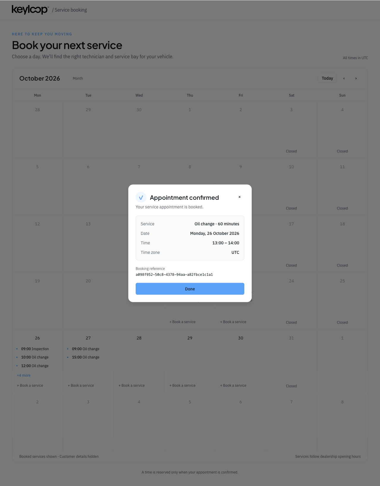

# Optimistic booking retest

Run: 2026-10-22T07:17:38.079Z to 2026-10-22T07:19:13.755Z
Environment: main checkout, Nest API 3006, web 5175, local Supabase PostgreSQL 55322. Database integration tests use the separate scheduler_test database on 54329.

## Automated checks

| Suite | Passed | Skipped |
|---|---:|---:|
| API unit | 111 | 0 |
| API HTTP | 68 | 0 |
| PostgreSQL integration | 62 | 0 |
| Web | 172 | 3 |
| Total | 413 | 3 |

API and web typechecks and API lint passed. The three skipped tests are opt-in inventory live tests, outside booking scope.

## Live checks

- PASS: HTTP auto matching persists qualified independent resource pairs.
- PASS: Ten simultaneous confirmations produce one winner.
- PASS: Reschedule rolls back conflicts, rejects stale versions and cancellation releases claims.
- PASS: Racing reschedule and create cannot share destination.
- PASS: An in-flight slot CAS does not block another hour or date for the same resources.
- PASS: Service and completion statuses retain occupied slots.
- PASS: No explicit pessimistic SQL remains in booking runtime.
- PASS: Two-browser Realtime disables occupied slot without reload.
- PASS: Browser guest booking persists matching resources and optimistic claims.

Ten concurrent confirmations for one qualified technician and hour returned one HTTP 201 and nine HTTP 409 responses. A create racing a reschedule had exactly one winner. Other hours and dates remained bookable while a same-slot compare-and-swap was waiting.

Browser proof: both tabs selected Oil change at 13:00 on 26 October. Tab A confirmed; Tab B received availability_changed WebSocket messages before refetching availability and calendar data, displayed Fully booked, and disabled confirmation. Cleanup re-enabled the slot without a reload.

Public booking creation was exercised through HTTP and the browser. Admin reschedule/status actions in the live harness use the Nest service directly; authenticated admin HTTP behavior is covered by the automated HTTP suite.

## Cleanup

Removed 11 uniquely tagged test bookings and unreferenced test customers/vehicles. Original data hashes match: 4 bookings, 3 users, 3 vehicles. Resource slot baseline restored: 10 rows, total occupancy 12, 2 historical shared rows.

## Limits

No sustained load/soak, process-crash, database-failover, or authenticated admin browser test was performed in this retest. These results establish local functional and concurrent correctness for the tested cases, not production capacity.

