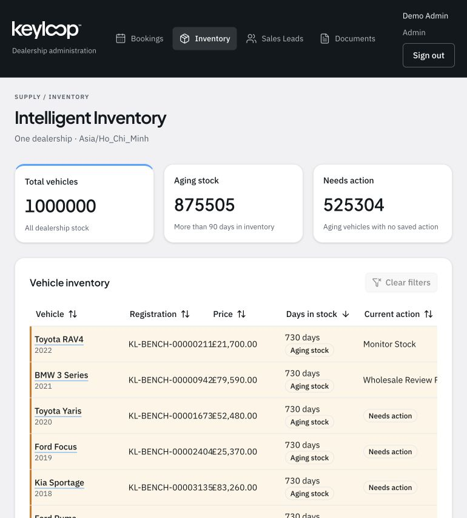
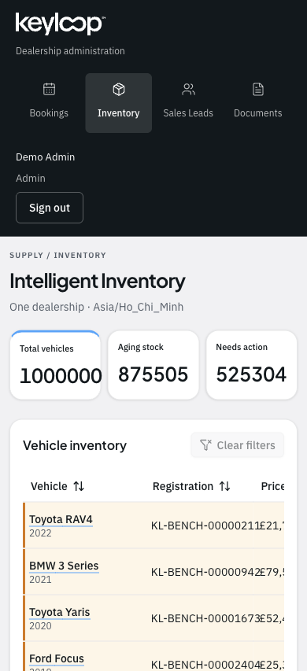

# Responsive navigation review

Scope: the shared dealership navigation and account controls on `/admin/inventory`.
Captured from the running local application on 22 October 2026. Review only;
application source and business data were not changed. Temporary viewport
emulation was cleared afterward.

## 1. Tablet, 770 × 853 — usable but crowded

All four routes, the active state, account identity and readable Sign out control
are visible. No page-wide horizontal overflow was measured (770px document width).
The 128px header places brand, navigation and account identity in one row. The
account block determines much of that height, while navigation links are 38px
high. This gives account details disproportionate prominence and leaves limited
room for longer names or labels. Treat longer names/translated labels as an
untested risk, rather than confirmed overflow.

Recommendation: use a compact header with a menu trigger at this width, keeping
the existing desktop sidebar above the responsive breakpoint. Use comfortable
44px-or-larger touch controls in the menu.

## 2. Phone, 390 × 853 — needs a layout change

All navigation labels remain readable, the selected route is clear, and the
Sign out button has visible contrast. No page-wide horizontal overflow was
measured (390px document width). However, the header stacks into three sections:
brand, navigation, then a left-aligned account block. It is 301px tall, taking
35% of the viewport before the page content begins. The 95px account section
adds a large empty area to its right. This pushes the user's inventory work
unnecessarily far down the screen.

Recommendation: a roughly 64px header with the existing logo and an accessible
Menu button. Open the existing shared navigation in a drawer; keep identity,
role and Sign out at the drawer bottom. The drawer should expose the active
route, close after navigation, contain keyboard focus while open, close on
Escape, and restore focus to its trigger. Keep the existing colors, logo,
role filtering and desktop sidebar.

## Evidence and limits

Screenshots were saved and visually inspected. `measurements.json` records DOM
geometry from those same rendered states. Scope excludes the inventory table,
other routes, business workflows and authentication behavior. Keyboard,
screen-reader, zoom, localization and real-device touch testing were not
performed; this is not a WCAG compliance assessment.
